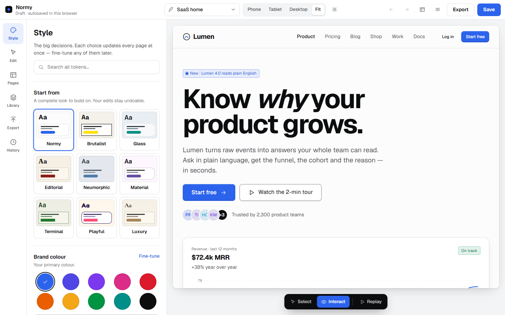

# Normy — design your UI visually

Normy is a studio for the look and feel of a product. Pick a style, click anything on a real page to
refine it, and every page updates live. When you're happy, save versions and export real code (CSS,
Tailwind v4, TypeScript or W3C design tokens).



## Start

```bash
pnpm install
pnpm dev            # http://localhost:3000  (use --port 3001 if 3000 is taken)
```

Open **`/studio`**. The first visit asks you to pick a starting look.

## How you work in the Studio

| Step | Where | What you do |
|---|---|---|
| 1. Style | **Style** panel | Big choices, one click each: starter look, brand colour (or any colour), neutrals, corners, spacing, fonts, depth, motion. *Fine-tune* opens the exact tokens. |
| 2. Edit | **Edit** panel, or **Select** in the canvas dock (shortcut **I**) | Click an element. Choose *Every button / Only one style / Just this one*, pick a state tab (Hover, Pressed…), and change its essentials. *Show all properties* has everything else. |
| 3. Check | Top bar | Switch page, device (Phone/Tablet/Desktop/Fit) and light/dark. Compare shows before/after. |
| 4. Save & export | **Save**, **Library**, **Export** | Versions on disk (`design-systems/<id>/`), restore, compare, import, and five export formats. |

For experts, **Edit → Advanced** is the full cascade inspector: every scope (component, variant,
size, part, instance, state, breakpoint, mode), all 263 properties and where each value comes from.

**Comfort.** Drag the panel edge to resize it (double-click resets). The rail has **Aa** for interface
size (Small/Medium/Large) and **Hide** to give the canvas the whole width.

**Keyboard.** **Ctrl/⌘ K** commands · **I** select mode · **Esc** interact · **Ctrl Z / Ctrl ⇧ Z**
undo/redo · **Ctrl S** save. On preview pages, **Ctrl J** switches page and system.

## Other pages

| URL | What |
|---|---|
| `/` | Product home: starter looks you can try in place |
| `/preview/saas` … | 19 real product pages (11 marketing, 8 app screens) |
| `/preview/atlas` | Every component × variant × size × state |
| `/preview/motion` | Motion Lab |
| `/preview/analyzer` | Contrast, coverage, token usage, rule hygiene |

## Scripts

```bash
pnpm check          # typecheck + lint
pnpm e2e            # Studio end-to-end (own dev server on :3100)
pnpm screenshots    # all pages × 390/768/1440 × light/dark → screenshots/final
pnpm build          # production build
```

## Under the hood

Every visual and motion decision is data: a registry of 411 properties (148 tokens + 263 component
properties), resolved through an 8-level cascade into one stylesheet. See `docs/ARCHITECTURE.md`,
`docs/PROPERTY-SPACE.md` and `docs/DECISIONS.md`; progress is in `PROGRESS.md`.

- `engine/`: registry, cascade, compiler, exports, diff, contrast, runtime
- `components/normy/`: the library (65 components)
- `components/studio/`: the Studio
- `design-systems/`: your saved systems (git-ignored)
